# Procesné mapy: čo appka zatiaľ vie

Stav k 20. 10. 2026 o 12:12.

Procesné mapy je webová aplikácia, ktorá z popisu procesu urobí procesnú mapu. Dnes vie z vloženého textu nakresliť prehľadovú mapu s krokmi rozdelenými podľa rolí, ktorýkoľvek krok rozpísať na detailnú mapu a mapu ručne opraviť. Hotovú mapu môžeš poslať odkazom niekomu, kto nemá účet. Je zadarmo, s limitom 15 analýz mesačne na účet.

Prihlasuje sa odkazom v e-maile, bez hesla. Každý vidí len svoje mapy, kým ich sám nezdieľa odkazom.

## Prihlásenie a môj účet

Prihlási sa ktokoľvek s akoukoľvek e-mailovou adresou, bez pozvánky a bez hesla.

- Na úvodnej stránke zadáš e-mail a príde ti prihlasovací odkaz. Po jeho otvorení klikneš ešte na „Prihlásiť sa“, aby ho nespotrebovala automatická kontrola e-mailu. Nový odkaz si môžeš vypýtať najskôr o minútu.
- Keď je odkaz použitý alebo vypršal, aplikácia povie „Odkaz už neplatí“ a ponúkne poslanie nového.
- Na tom istom zariadení ostaneš prihlásený až 30 dní.
- Na stránke „Môj účet“ vidíš svoj e-mail, môžeš sa odhlásiť alebo si účet natrvalo zrušiť. Zrušenie zmaže všetky tvoje mapy a dáta.

Vedľa prihlásenia je ukážková mapa „Káva došla“: s nadhľadom ukazuje, ako procesná mapa vyzerá, ešte kým sa človek prihlási.

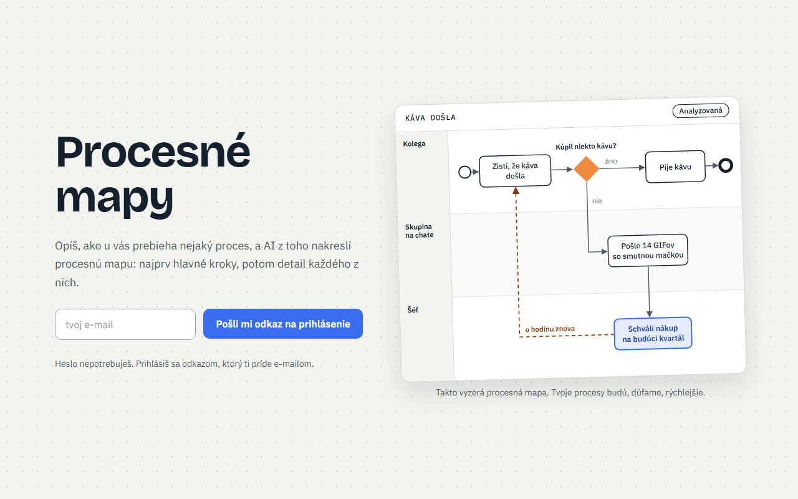

Po zrušení účtu ti príde e-mail „Tvoj účet bol zrušený“ ako potvrdenie.

## Moje mapy a vloženie textu

Nová mapa vzniká z textu, ktorý vložíš alebo napíšeš. Môže to byť aj skopírovaný zápis či prepis zo stretnutia.

- Text má 30 až 30 000 znakov, počítadlo pod poľom ukazuje, koľko sa ešte zmestí. Pole sa prispôsobí oknu a potiahnutím za roh sa dá zväčšiť.
- Názov je nepovinný, najviac 30 znakov. Bez názvu mapu pomenuje AI pri analýze.
- Zoznam „Moje mapy“ ukazuje názov, dátum, čas a stav každej mapy, najnovšie hore. Kým nemáš žiadnu mapu, stránka ukáže znudené oranžové rozhodnutie a tlačidlo „Dať mu prácu“, ktoré vedie na novú mapu. Tlačidlo „Upraviť“ pri mape otvorí jej detail a až tam si vyberieš, či chceš upraviť text mapy, alebo samotnú mapu.
- Text aj názov sa dajú kedykoľvek upraviť.
- Mapu môžeš natrvalo zmazať aj s textom, po potvrdení.
- Jeden účet môže mať najviac 200 máp.

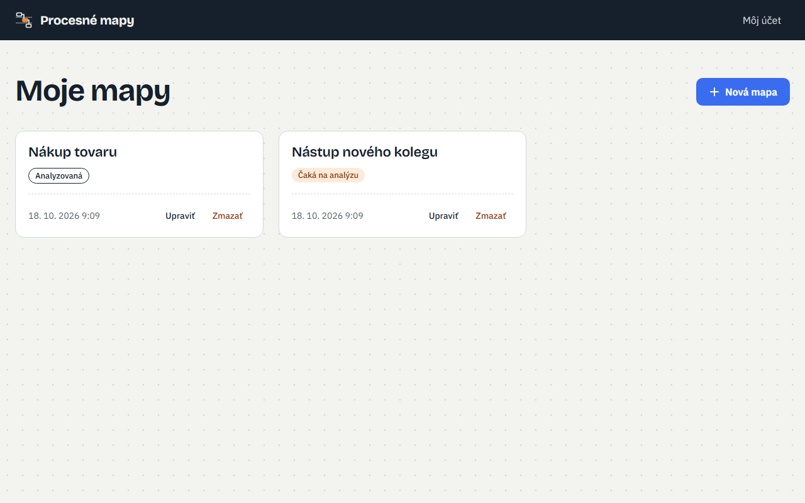

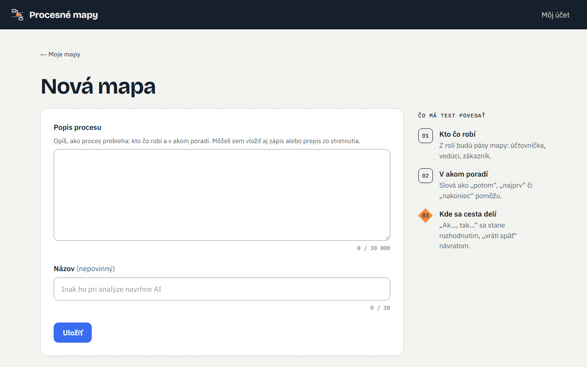

## Analýza AI a prehľadová mapa

Tlačidlo „Analyzovať“ pošle text AI a za pol minúty až minútu je na stránke prehľadová mapa. Pred prvou analýzou potvrdíš, že rozumieš, že text odchádza poskytovateľovi AI (Anthropic).

Mapa ukazuje:

- pásy podľa rolí, teda kto ktorý krok robí (krok bez zistiteľnej roly je v páse „Neurčené“),
- 3 až 11 hlavných krokov, začiatok, koniec a šípky medzi nimi,
- rozhodnutia ako kosoštvorec s otázkou a pomenovanými vetvami,
- návraty späť (napríklad na opravu) a kroky, ktoré bežia súčasne.

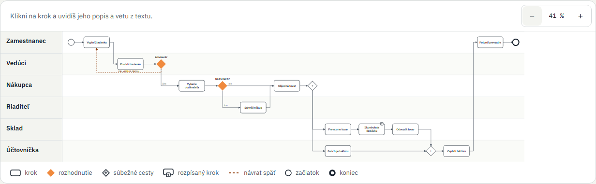

Po kliknutí na krok vidíš jeho popis a vetu z tvojho textu, z ktorej ho AI vyvodila. Mapa je v jazyku textu. Na počítači ju posunieš ťahaním myšou, na mobile ju posúvaš a zväčšuješ prstami.

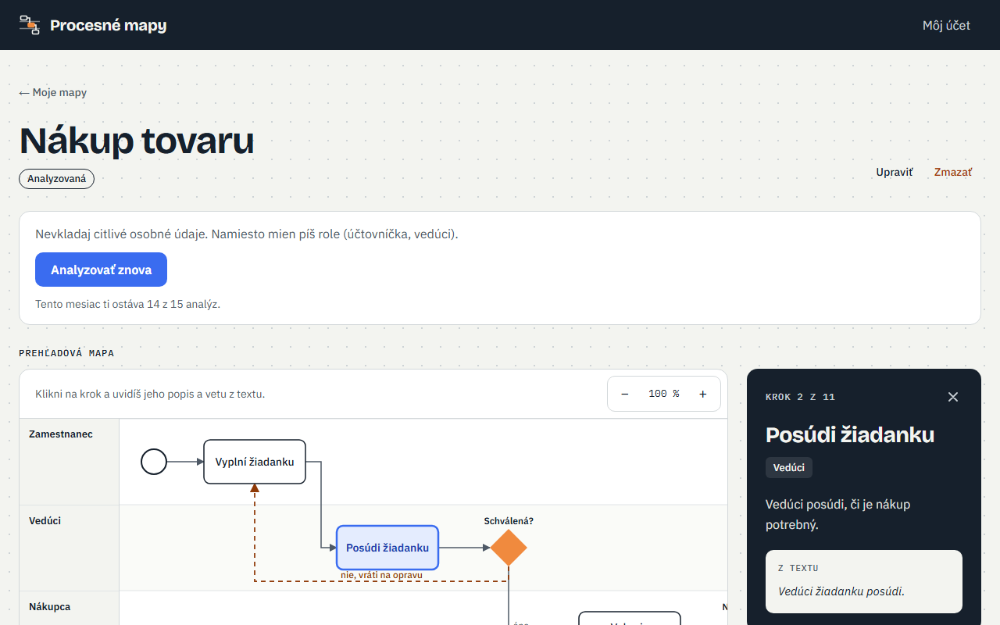

Analýza beží aj po zatvorení okna. Keď v texte nie je proces, aplikácia nič nenakreslí a poradí, čo doplniť. Pri výpadku sa pokus do limitu nezapočíta.

## Verzie mapy a limity

Každá úspešná analýza je nová verzia mapy aj s textom, z ktorého vznikla. Po úprave textu aplikácia ukáže, že mapa už nesedí, a ponúkne „Analyzovať znova“.

- Staršiu verziu si môžeš pozrieť, vrátiť sa k nej (vráti sa aj jej text) alebo ju natrvalo zmazať.
- Mapa má najviac 10 verzií. Pred jedenástou aplikácia povie, ktorú najstaršiu zmaže.

| Čo | Limit |
| --- | --- |
| Analýzy na účet | 15 mesačne, obnoví sa 1. dňa v mesiaci |
| Mapy na účet | 200 |
| Verzie na mapu | 10 |
| Dĺžka textu | 30 až 30 000 znakov |
| Rozpísania krokov na účet | 30 mesačne, obnoví sa 1. dňa v mesiaci |

Návrat k verzii limit neminie. Pri analýze vidíš, koľko analýz ti tento mesiac ostáva.

## Detailná mapa kroku

Ktorýkoľvek krok prehľadovej mapy sa dá rozpísať na detailnú mapu: čo presne sa v ňom deje, kto to robí a v akom poradí.

- Po kliknutí na krok tlačidlo „Rozpísať krok“ pošle AI text a krok. Zhruba za pol minúty má krok vlastnú stránku s detailnou mapou, aj keď okno medzitým zavrieš.
- Detailná mapa má 2 až 8 menších krokov a kreslí sa rovnako ako prehľadová: pásy podľa rolí, rozhodnutia, súbežné cesty a návraty. Pri každom menšom kroku je veta z textu.
- Keď text o kroku viac nehovorí, AI si nič nevymyslí a aplikácia poradí, čo doplniť.
- Rozpísaný krok je v prehľadovej mape označený a „Zobraziť detail“ ho otvorí.
- „Rozpísať znova“ po potvrdení nahradí detail novým, starý sa neuchová.
- Rozpísania majú vlastný limit 30 mesačne na účet, oddelený od analýz. Pri tlačidle vidíš, koľko ti ostáva.

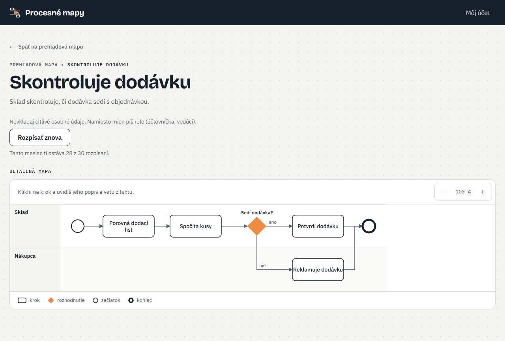

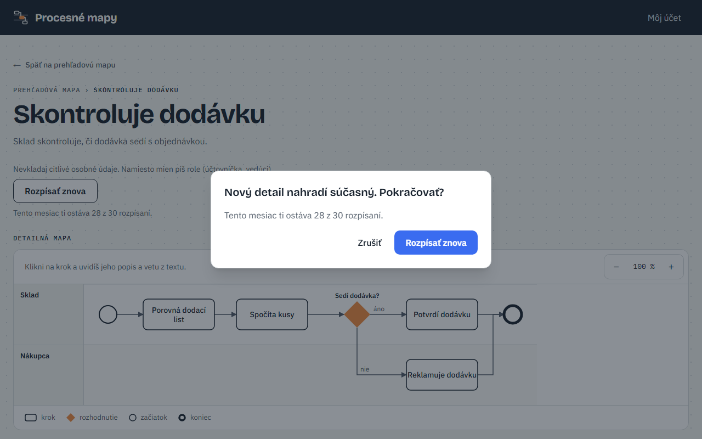

Detaily patria k verzii mapy. Nová analýza začína bez rozpísaných krokov a návrat k staršej verzii vráti aj jej detaily. Pri staršej verzii sa detaily dajú otvoriť, no nové sa nerozpisujú. Zmazanie verzie, mapy aj účtu zmaže aj detaily.

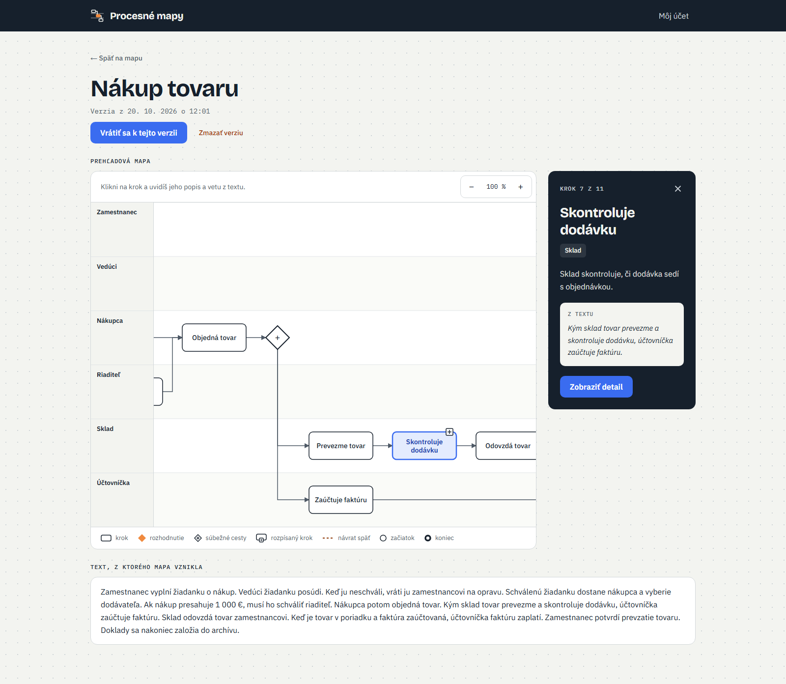

## Ručná úprava mapy

Keď AI niečo pochopí zle, mapu opravíš sám a nemusíš míňať analýzu. Tlačidlo „Upraviť mapu“ je pri platnej verzii mapy, upravuje sa na počítači.

- Prepíšeš názov a popis kroku, otázku rozhodnutia aj názvy vetiev.
- Pridáš krok, ktorý AI vynechala, alebo zmažeš krok navyše. Mapa môže mať najviac 25 krokov.
- Pridáš alebo zmažeš aj rozhodnutie, súbežné cesty (rozdelenie a spojenie), začiatok a koniec.
- Na šípku klikneš priamo na mape a pomenuješ ju alebo zmažeš. Nové šípky kreslíš v paneli kroku, aj tie, ktoré vedú späť.
- Ktorýkoľvek prvok mapy (krok, rozhodnutie, začiatok, koniec aj súbežné cesty) potiahneš, kam chceš. Keď ho pustíš v inom páse, dostane inú rolu. Šípky idú za ním a prvok nikdy neprekryje iný.
- Pás premenuješ, posunieš hore alebo dole, alebo pridáš nový.
- Tlačidlo „Usporiadať“ rozloží celú mapu nanovo, ako po analýze. Keď sa ti to nepáči, „Späť“ vráti tvoje rozloženie.
- Nový prvok sa postaví hneď za vybraný, na voľné miesto.
- Počas úpravy máš „Späť“ a „Znova“, zmeny „Uložíš“ alebo „Zrušíš“.

Prvé uloženie založí verziu „Upravená ručne“ a návrh od AI ostane ako staršia verzia. Mapa si tvoje rozloženie pamätá aj po návrate k inej verzii a späť. Zmenený krok má značku „Upravené ručne“, pridaný krok má namiesto vety z textu „Pridané ručne“ a dá sa rozpísať. Detaily krokov sa do novej verzie prenesú.

Keď zmeníš názov, popis alebo rolu kroku, ktorý už máš rozpísaný, jeho detail ukáže „Krok sa zmenil, skontroluj, či detail ešte sedí.“ Tlačidlo „Detail sedí“ upozornenie zadarmo skryje, „Rozpísať znova“ detail nahradí novým.

Mapu uložíš, aj keď ešte nie je hotová. Miesta, kde niečo chýba, majú červený výkričník a nad mapou je zoznam, čo treba dorobiť: krok bez šípky, chýbajúci začiatok alebo koniec, rozhodnutie s jednou vetvou či súbežné cesty, ktoré sa nespoja. Keď miesto opravíš, značka zmizne.

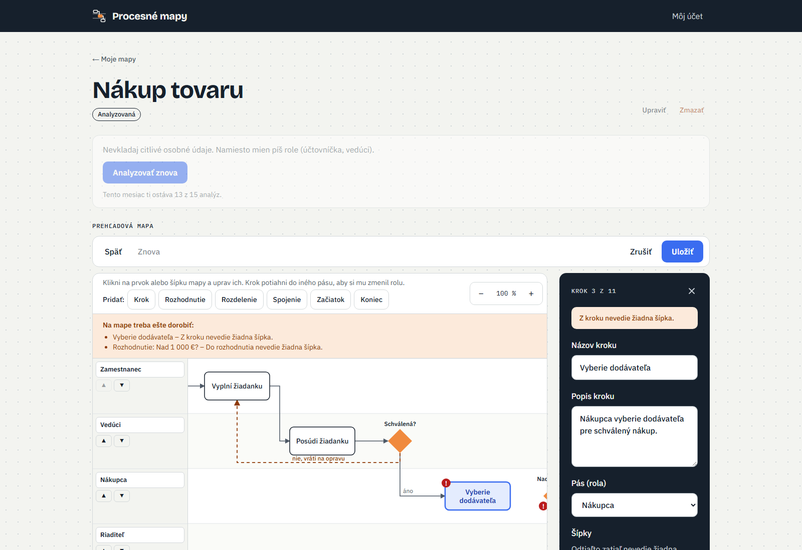

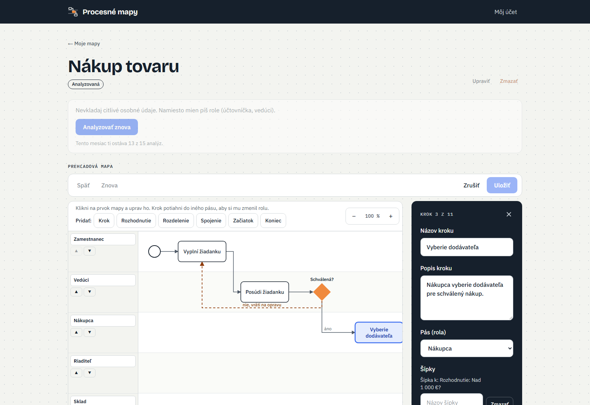

### Analyzovať znova s tvojimi opravami

Keď je platná verzia ručne upravená, pri „Analyzovať znova“ je zaškrtnuté „Zachovať moje ručné opravy“. AI potom dostane okrem textu aj tvoju opravenú mapu a zachová z nej kroky, roly, šípky aj polohy prvkov. Kde novší text hovorí niečo iné než tvoja oprava, vyhrá text. Kroky z tvojich opráv majú aj v novej verzii značku „Pridané ručne“ alebo „Upravené ručne“ a mapa smie mať až 25 krokov.

- Nová mapa je nová verzia bez rozpísaných krokov a ručne upravená verzia ostane medzi staršími, takže sa k nej vrátiš, keď AI niektorú opravu nezachová.
- Rátá sa ako jedna analýza z 15.
- Keď políčko odškrtneš, vznikne mapa len z textu, ako pri prvej analýze.
- Pri verzii od AI sa políčko neukáže, lebo nie je čo zachovať.

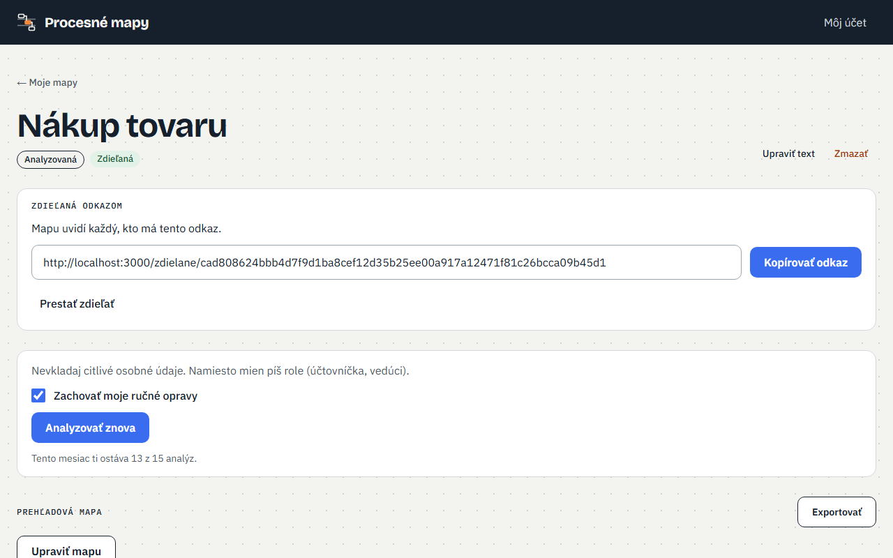

## Zdieľanie mapy odkazom

Analyzovanú mapu môžeš ukázať niekomu, kto nemá účet a nemusí si ho zakladať. Pošle sa jej zdieľaný odkaz, ktorý si skopíruješ a pošleš, kam chceš, napríklad e-mailom či správou. Aplikácia nič neposiela sama.

- Pri analyzovanej mape je tlačidlo „Zdieľať“. Rozpracovaná mapa, ktorá ešte nemá analýzu, ho nemá.
- Po zapnutí uvidíš odkaz, vetu „Mapu uvidí každý, kto má tento odkaz.“ a tlačidlo „Kopírovať odkaz“. Mapa je na svojej stránke označená ako „Zdieľaná“.
- Mapa má najviac jeden odkaz. Keď „Zdieľať“ zapneš znova, ukáže sa ten istý.
- „Prestať zdieľať“ odkaz hneď zruší, bez potvrdenia. Keď zdieľanie zapneš znova, vznikne nový odkaz a starý ostane mŕtvy.
- Zmazanie mapy aj zrušenie účtu odkaz zrušia samy.

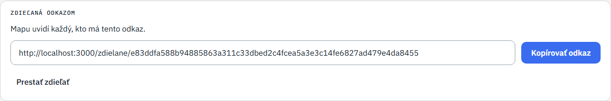

### Čo vidí ten, komu odkaz pošleš

Odkaz otvorí ktokoľvek bez prihlásenia, aj na mobile. Vidí názov mapy a prehľadovú mapu, po kliknutí na krok jeho popis a pri rozpísanom kroku „Zobraziť detail“ s detailnou mapou a cestou späť. Všetko je len na čítanie.

- Nevidí text, z ktorého mapa vznikla, vety z textu, značky „Pridané ručne“ a „Upravené ručne“, upozornenie „Krok sa zmenil“, zoznam verzií ani tvoj e-mail.
- Nemá tlačidlá na úpravu, analýzu ani rozpísanie, takže nič nezmení a nič ťa nestojí z limitov.
- Odkaz ukazuje vždy platnú verziu. Po ručnej úprave, novej analýze či návrate k staršej verzii ho netreba posielať nový.
- Kto odkaz dostal, môže ho poslať ďalej, preto ho posielaj len tým, ktorým mapu chceš ukázať.
- Odkaz je dlhý a náhodný a stránka nemá byť vo vyhľadávačoch. Aplikácia si nezapisuje, kto a kedy odkaz otvoril.
- Odkaz, ktorý už neplatí, aj vymyslený odkaz ukážu tú istú stránku „Tento odkaz už neplatí alebo nikdy neexistoval“, takže z nej nikto nezistí, či mapa existovala.

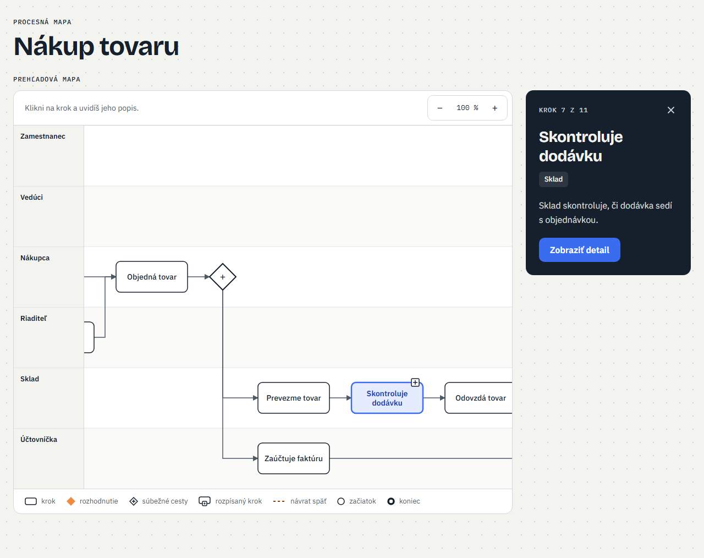

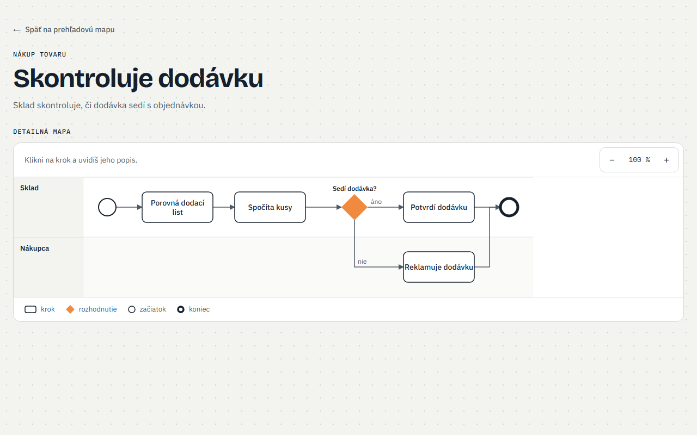

## Čo zatiaľ nevie a čo príde ďalej

Dnes appka berie len vložený text. V tomto poradí prídu:

1. Nahratie dokumentu (Word, PDF…) ako vstupu.
2. Nahratie záznamu alebo prepisu stretnutia.
3. Spojenie viacerých vstupov do jednej mapy.
4. Export mapy ako obrázok alebo PDF.

Neskoršie, mimo tohto zoznamu: platby, prihlásenie cez Microsoft či Google a spoločné priestory pre kolegov z jednej firmy.
